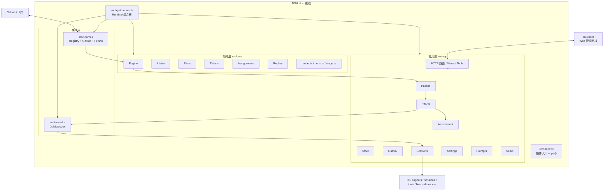
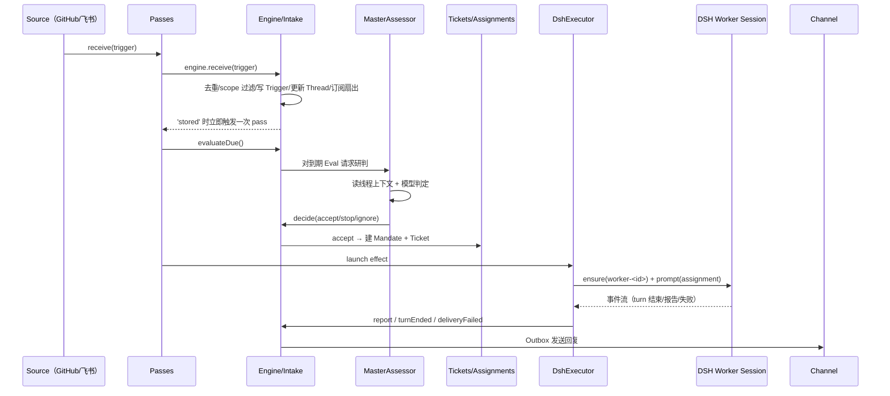

# 01 · 项目总览

## 1. 这是什么

`dsh-superagent` 是一个**面向单个仓库的主动式编码 Agent**，以 DSH bundle/插件形态运行。它把“人或其他系统在 GitHub/飞书里发出的消息”变成可追踪、可授权、可执行的工单，并让每个工单在独立的 Agent Session 中完成。

它解决的问题不是“让模型写代码”，而是：

1. **接入**：持续监听 GitHub 通知、Issue/PR 讨论、CI、飞书消息。
2. **筛选**：用确定性规则（Policy/Gate）先挡掉不该处理的消息，再让模型只对少量候选做研判。
3. **授权**：区分“显式请求”和“规则推断”，不同授权强度对应不同的工作范围。
4. **执行**：每个工单一个独立 Session、独立工作目录、独立并发槽，互不污染。
5. **回写**：把执行结果、阻塞、问题、结束原因回写到来源会话，并保证幂等。

### 不是什么

- 不是多仓库平台：一个部署实例服务一个 GitHub 仓库。
- 不是通用聊天机器人：核心是工单生命周期，不是对话。
- 不是研究成品：README 明确标注为研究原型，接口和状态可能随版本演进。

## 2. 技术栈与运行形态

| 层 | 技术 |
| --- | --- |
| 语言/运行时 | TypeScript（ES2024）、Node.js `^22.19.0 || >=24.0.0` |
| 包管理/构建 | pnpm 11.7、tsdown 0.22（ESM + 浏览器 CJS 双产物） |
| 插件框架 | Cordis `@deepseek-ai/cordis` 4.0.5-alpha.1 |
| 宿主能力 | DSH：agents、sessions、tools、systemPrompt、skills、webServer、llm、subprocess |
| 持久化 | `node:sqlite`（WAL + FULL synchronous），JSON 列 + 生成列/部分索引 |
| 校验 | zod 4 |
| 锁 | `proper-lockfile`（状态目录单实例锁） |
| 前端 | React 18 + TSX，Cordis 客户端模块加载器 |
| 测试 | Vitest 4，59 个 `tests/*.spec.*` |

运行时有三种角色：

1. **Host 进程**：由 DSH 启动，加载 `dsh-superagent` 插件，运行 `Runtime`，对外暴露管理 API 与面板。
2. **Main Session（编排者）**：`dsh-superagent-router` 预设，负责路由、评估、决策、回复、订阅管理。
3. **Executor Session（工人）**：每个 Ticket 一个 `worker-<ticketId>`，在独立目录中执行具体工作。

## 3. 分层架构

依赖方向的基本规则：

- `core` 不依赖 `app`、`sources`、`executor`、`client`，只依赖 `model/ports/stage/errors/reasons/ids`。
- `app` 是唯一组合根，负责把所有实现注入 `Engine`。
- `sources` 通过 `SourceRegistry` 实现 `SourceScope` 端口，并把 Trigger 交给 Engine。
- `executor` 实现 `Executor` 端口，通过 `Sessions` 操作 DSH Agent。
- `client` 只依赖类型契约（`src/app/api.ts`）与 HTTP，不打包宿主代码。

## 4. 端到端主流程

阶段说明：

1. **接收**：`Source` 把外部消息规范化为 `Trigger`，经 `Passes.receive` 进入 Engine。
2. **准入**：`Intake` 做时间归一、去重、`scope` 过滤、Thread 维护与订阅扇出，然后排队评估。
3. **评估**：`Evals` 用 `Policy.gate` 先做确定性门槛；通过后交给 `MasterAssessor` 读上下文并让模型给出 `accept/stop/ignore/unavailable`。
4. **建单**：`accept` 时创建 `Mandate`（授权依据）与 `Ticket`，并把同批 Trigger 挂到工单上。
5. **派工**：`Assignments` 创建 Assignment，`DshExecutor` 准备目录、启动/唤醒 worker Session。
6. **执行**：worker 读工单、执行命令、产出 `Report`（progress/waiting/ready/blocked/failed/dropped）。
7. **回写**：`Engine` 记录报告，`Outbox` 按 Ticket+会话顺序、幂等地把消息发回来源渠道。

## 5. 关键设计选择

| 选择 | 原因 | 代价/约束 |
| --- | --- | --- |
| 单一 `Engine` 写入口 | 所有状态变更集中，事务边界清晰 | Engine 方法必须覆盖所有场景，不能绕过 |
| Trigger/Eval/Ticket 分离 | 消息、判断、工作三者生命周期不同 | 状态字段多，需理解转换规则 |
| 确定性 Gate 先于模型 | 控制成本与误触发 | 规则配置错误会直接漏掉/误收消息 |
| 每 Ticket 独立 Session/目录 | 隔离上下文与文件改动 | 资源开销高，需要并发槽 |
| 持久化 Effects 队列 | 崩溃后可恢复、可重试、可限流 | 逻辑复杂，需理解顺序与幂等 |
| Outbox + receipts | 回复不重复、不乱序 | 发送失败要能撤回/重试 |
| 版本化 Settings/Prompts | 保存可审计、可回滚、乐观并发 | 每次保存都有 revision 冲突处理 |
| 默认仅监听 loopback | 管理面不暴露公网 | 远程访问需要自行做隧道/代理 |

## 6. 代码地图（入口级）

| 路径 | 作用 |
| --- | --- |
| [`src/index.ts`](../../src/index.ts) | Cordis 插件入口，声明 `inject`，创建 `Runtime`，注册停止副作用 |
| [`src/app/runtime.ts`](../../src/app/runtime.ts) | 组合根：锁目录、建 Store、Setup、Prompts、Effects、Registry、Sessions、Engine、Passes、HTTP |
| [`src/core/engine.ts`](../../src/core/engine.ts) | 领域唯一写入口，聚合五个内部 part |
| [`src/core/model.ts`](../../src/core/model.ts) | 所有领域类型与判定辅助函数 |
| [`src/core/ports.ts`](../../src/core/ports.ts) | Policy/Assessor/Executor/Outbox/Repositories 等端口 |
| [`src/sources/registry.ts`](../../src/sources/registry.ts) | Source 插件注册与 `SourceScope` 实现 |
| [`src/executor/dsh.ts`](../../src/executor/dsh.ts) | DSH 执行器实现 |
| [`src/app/http.ts`](../../src/app/http.ts) | 管理 API 路由与同源校验 |
| [`src/client/index.tsx`](../../src/client/index.tsx) | 面板注册入口 |
| [`cordis.patch.yml`](../../cordis.patch.yml) | bundle 装配：插件、worker/router 预设 |
| [`scripts/dsh-superagent`](../../scripts/dsh-superagent) | 本地服务生命周期管理（tmux + 健康检查） |

## 7. 能力边界与已知限制

- **单实例单仓库**：`stateDir` 上有文件锁，重复启动会被拒绝。
- **GitHub 账号隔离**：Agent 以自己的 `gh` 账号行事，部署时校验推送权限；不是用你的个人账号。
- **飞书可选**：未配置时 Source 不启用，编排仍可运行。
- **研究原型**：`README` 明确说明接口、数据格式、行为可能变化；升级可能触发 schema 迁移。
- **模型不是权限边界**：Prompt 只影响“告诉模型什么”，真正的工具权限、Gate、账号包装仍在代码层。
- **管理 API 仅 loopback**：`registerHttp` 只接受本机回环地址并校验同源请求头。

## 8. 下一步

- 想理解状态如何流转：读 [02-domain-model.md](./02-domain-model.md) 与 [03-core-engine.md](./03-core-engine.md)。
- 想知道进程如何装配与恢复：读 [04-application-layer.md](./04-application-layer.md)。
- 想实际跑起来：直接读 [08-deployment-and-run.md](./08-deployment-and-run.md)。
