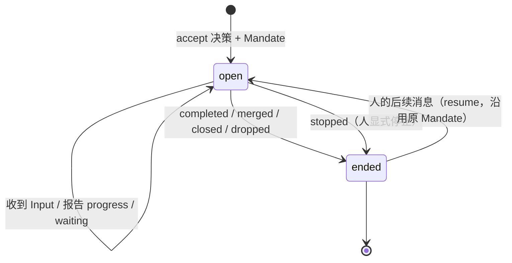
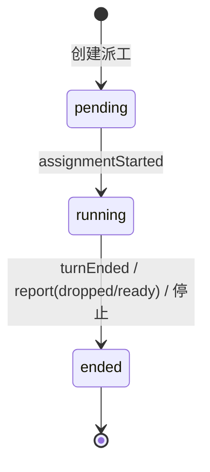
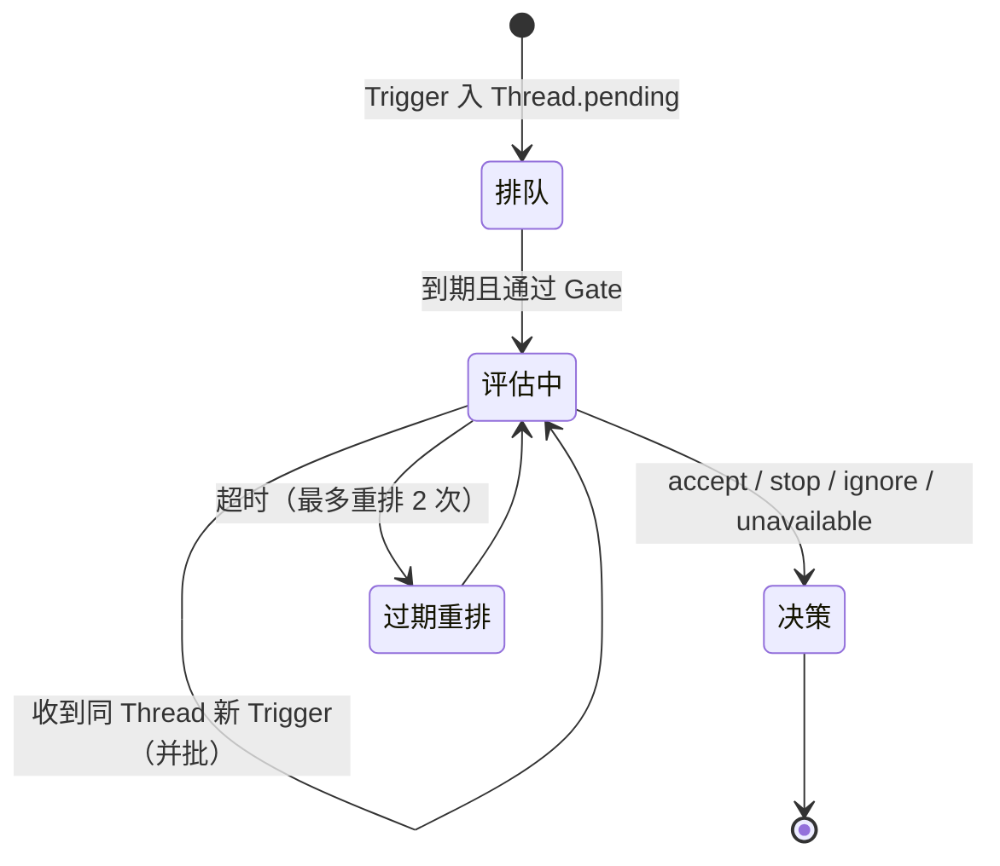
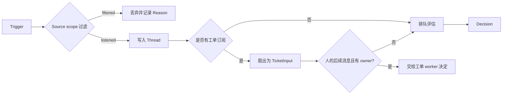

# 02 · 领域模型与不变量

> 对应源码：`src/core/model.ts`、`src/core/stage.ts`、`src/admission.ts`、`src/core/reasons.ts`。

## 1. 概念总表

| 概念 | 角色 | 关键字段 | 生命周期 |
| --- | --- | --- | --- |
| Source | 外部账号/接入点 | `kind`、`enabled`、`config` | 长期存在，可启停 |
| Thread | 会话/上下文边界 | `key`、`ref`、`subscriptions`、`pending`、`evaluating` | 长期存在，无明确删除 |
| Trigger | 一条不可变外部消息 | `id`、`source`、`threads[]`、`actor`、`human`、`addressed`、`text`、`meta` | 不可变 |
| TriggerDisposition | Trigger 的去向审计 | `evalId`、`decisionId`、`fanout[]`、`context[]`、`requeued`、`handbacks` | 随处理更新 |
| Evaluation | 一次进行中的评估 | `id`、`threadKey`、`triggerIds[]`、`strength`、`deadline`、`delivered` | 线程内至多一个，结束即转 Decision |
| Decision | 评估结论 | `kind`、`reason[]`、`strength`、`ticketId?`、`audit?` | 不可变审计记录 |
| Mandate | 执行授权 | `strength`、`policyVersion`、`basis`、`actor`、`scope` | 创建后不可变 |
| Ticket | 一项被接管的工作 | `mandate`、`origin`、`assignments[]`、`inputs[]`、`follows`、`attention`、`ended` | open → ended |
| Assignment | 一次执行尝试 | `state`、`startedAt`、`endedAt`、`report`、`deliveredAt`、`idleAt` | pending → running → ended |
| TicketInput | 送进工单的新信息 | `kind`（trigger/policy-changed/reopen/resumed/text/note）、`readAt`、`deliveredTo` | 追加式 |
| Follow | 工单跟随的 Thread | `thread`、`own`、`closed{outcome}` | 随 PR 关闭更新 |
| Report | worker 的一次汇报 | `state`、`summary`、`at` | 挂在 Assignment 上 |
| Attention | 等待人回答的问题 | `question`、`triggerId?` | 工单结束时清除 |
| PolicyEffect | 策略变化对工单的影响 | `rules`、`proactive`、`requesterAllowed` | 作为 Input 写入 |

## 2. 状态机

### 2.1 Ticket

- `ended.by`：`executor`（执行器判定结束）或 `human`（人停止）。
- `ended.outcome`：`completed`、`merged`、`closed`、`dropped`、`stopped`。
- `liveTicket = !ended`。
- 结束不是物理删除；后续人可以恢复它，沿用原授权。

### 2.2 Assignment

- 一个 Ticket 同时最多一个 `running` Assignment。
- `latestAssignment`、`runningAssignment`、`latestReport` 是常用读取辅助函数。

### 2.3 Evaluation / Decision

- 同一 Thread 同时最多一个 `Evaluation`。
- `deadline` 从候选送达 Assessor 后开始计算；处理暂停时会把截止时间顺延。
- 连续过期第三次会产生 `unavailable` 决策，而不是无限重试。

### 2.4 Trigger 去向

`followupOwners` 决定“这条人的后续消息由哪个工单的 worker 决定”。一旦有 owner，主 Session 只能停止工作，不能重新路由。

## 3. 授权模型

### 3.1 Strength

| 值 | 含义 | 允许范围 |
| --- | --- | --- |
| `explicit` | 来源中明确 @ 智能体或直接私聊 | 按请求执行 |
| `inferred` | 规则/准入表推断出的主动机会 | 仅限规则范围内的小改动；越界应 `dropped` |

### 3.2 MandateBasis

`MandateBasis` 记录“Gate 为什么放行”，用于审计与重新校验：

| `via` | 触发条件 | 关键字段 |
| --- | --- | --- |
| `addressed` | 白名单发送者 @ 智能体 | `addressed: mention/direct` |
| `followup` | 有工单的 Thread 上的人的消息 | `authority?` |
| `admission` | 准入表某一行判定为 inferred | `cell`、`observation` |
| `listed` | 旧版本按白名单直接接受 | `addressed?`、`authority?` |
| `bot` | 白名单机器人评论（最多 inferred） | `observation` |

`sender` 记录接受时的允许发送者，`rules` 记录命中的规则 ID。策略变化后 `revalidate` 会依据 basis 重新判断。

### 3.3 准入矩阵

`src/admission.ts` 定义三个维度：

| 单元格 | 含义 | 允许结果 |
| --- | --- | --- |
| `listedUnaddressed` | 白名单发送者但没 @ | `inferred` / `ignore` |
| `unlistedAddressed` | 非白名单但 @ 了智能体 | `explicit` / `inferred` / `ignore` |
| `unlistedUnaddressed` | 非白名单且没 @ | `inferred` / `ignore` |

默认值：`listedUnaddressed = inferred`，其余 `ignore`。

## 4. 关键不变量

1. **一条 Trigger 只处理一次**：`Intake.receive` 按 `id` 去重，重复返回 `duplicate`。
2. **Thread 是评估一致性边界**：同一 Thread 同时只有一个 `evaluating`；新 Trigger 进入 `pending`，在下一轮并批。
3. **Decision 必有一组 Reason**：每个触发批次都有对应理由码，无法判定时给 `unavailable`。
4. **Mandate 不可变**：`accept` 时一次性生成，之后执行只能在其 `scope` 内进行。
5. **Ticket 的回复渠道来自接受时的消息**：`channels` 固定，后续回复不会凭空选择新渠道。
6. **Assignment 串行**：同一 Ticket 不会同时运行两个 worker；重试会新建 Assignment。
7. **Input 追加式**：`inputs` 只增不减；`undelivered` 是待投递子集。
8. **人优先**：人显式停止（`stop`）优先于自动流程；`waitsForPerson` 为真时工单停在 `person/blocked|failed`。
9. **结束可恢复**：`ended` 的工单可被人的后续消息恢复，但仍用原 Mandate；不是重新授权。
10. **状态时间可比**：所有时间经 `isoTime` 归一为 ISO 字符串，保证字典序比较正确。

## 5. 工单阶段（对外展示口径）

`src/core/stage.ts` 的 `ticketStage` 把内部字段折叠为稳定的展示阶段：

| 阶段 | 判定 |
| --- | --- |
| `person/delivery` | 有 Input 投递失败 |
| `person/answer` | 有 `attention` 问题待回答 |
| `person/review` | 最新报告 `ready` |
| `person/blocked` | 最新报告 `blocked`，且没有更新的人消息 |
| `person/failed` | 最新报告 `failed`，且没有更新的人消息 |
| `working/queued` | 有 Assignment 但尚未 running |
| `working` | 有 running Assignment |
| `idle` | worker 结束一轮但未报告 |
| `ended` | 已结束 |

`canRetry` 决定面板是否允许重试。

## 6. 常用判定函数

| 函数 | 用途 |
| --- | --- |
| `threadKey(ref)` | 生成全局限定的 Thread key：`source:id` |
| `isoTime(value)` | 时间归一 |
| `followupOwners(trigger, records)` | 找出应处理人的后续消息的工单 |
| `settled(decision)` | 判断决策是否真正解决了请求 |
| `liveTicket(ticket)` | 是否未结束 |
| `runningAssignment(ticket)` | 当前运行中的派工 |
| `latestAssignment(ticket)` | 最后一次派工 |
| `latestReport(ticket)` | 最后一次报告 |
| `readUntil(ticket, progress)` | worker 最后读到输入的时间下界 |
| `waitsForPerson(ticket)` | 是否在等人处理 |
| `reached(ticket, trigger, thread, context)` | Trigger 是否到达过工单 |

## 7. 与展示层的关系

- 面板不直接解释内部字段，而是通过 `src/app/views/*`、`src/app/cards.ts` 生成稳定视图。
- 工单状态以 `ticketStage` 为准；决策以 `Decision.kind + reason` 为准；线程以 `Evaluation` 与 `Decision` 历史为准。
- 任何新增状态字段都应同步：`model.ts` → `store` 列/迁移 → `views` → `client` 类型 → 测试。

## 8. 常见误解

- **“Trigger 到了就等于工单收到了”**：不一定。`scope` 可能过滤；也可能只扇出到工单的 context 订阅，不授予任何权限。
- **“工单结束就不能再动”**：人可以恢复；恢复不等于重新授权。
- **“忽略决策等于消息没来过”**：Decision 会保留审计；`settled()` 还会区分“只是因为不明确而停止”。
- **“机器人评论能发起工作”**：不能。机器人最多产生 inferred 候选，永远不能成为 explicit 请求或停止指令。
