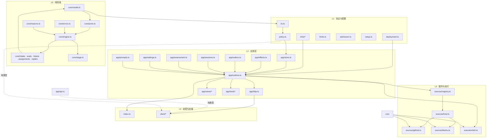
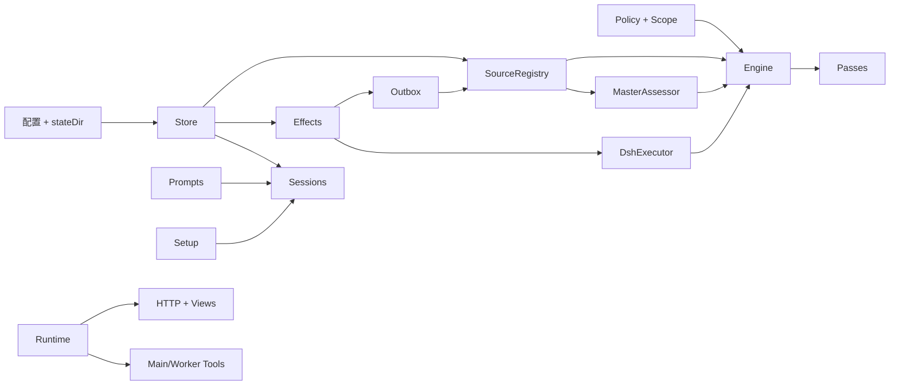

# 10 · 依赖关系图

> 这一篇回答三个问题：谁依赖谁、运行时对象怎么组装、哪些耦合是风险点。
>
> 基于 `src/` 的实际 import 关系整理；文件全部在 [src/](file:///workspace/src)。

## 一句话结论

依赖是**单向分层**的：`core` 不认识任何上层，`app` 依赖 `core` 与基础设施，`sources` / `executor` 依赖 `core` 的端口与 `app` 的少量宿主能力，`index` 负责最后装配。唯一破例的是面板：它通过 `app/api.ts` 的**纯类型**与宿主通信。

## 1. 分层图



### 各层规则

| 层 | 可以依赖 | 禁止依赖 | 理由 |
| --- | --- | --- | --- |
| `core` | 只依赖自身与 `zod` 等纯库 | `app`、`sources`、`executor`、Node 专属能力 | 领域内核要能在内存里跑完整状态机，便于测试与复用 |
| `infra` | Node 标准库 | `app` / `core` 业务 | 通用工具，保持无业务 |
| `kv` / `policy` / `deployment` / `setup` | `core` 类型 | `app` | 它们是“配置与键名”的单一事实源 |
| `app` | `core`、配置层、`infra` | 不反向依赖 `executor` 的类（只通过端口） | 应用层编排，执行器是可替换实现 |
| `sources` | `core` 类型、`deployment`、`infra`、`kv` | 不直接碰 `Store` / `Engine` 业务方法 | 只能通过 `SourceContext` |
| `executor` | `core` 端口、`app` 的 Store/Effects/Sessions | 不直接改领域状态 | 所有状态变更回报给 Engine |
| `client` | `app/api.ts`（纯类型）、`core` 的类型常量 | 任何 Node 模块、宿主实现 | 浏览器 bundle 不能带 Node 代码 |
| `index` | 全部 | — | 唯一允许“知道一切”的地方 |

## 2. 模块依赖矩阵

| 模块 | 被谁依赖 | 依赖谁 |
| --- | --- | --- |
| `core/model` | 几乎所有 | 无（纯类型 + 少量函数） |
| `core/ports` | engine、runtime、executor | model |
| `core/engine` | runtime、source-context、executor | model、ports、五个 part |
| `core/index` | app、sources、executor | 汇总导出 |
| `kv` | app、sources、executor | 仅类型 |
| `policy` | app、sources、executor | model、limits、admission |
| `deployment` | app、sources、infra | 无业务依赖 |
| `app/store` | runtime、executor、source-context | kv、model、policy |
| `app/effects` | runtime、executor | kv |
| `app/outbox` | runtime | effects、registry |
| `app/sessions` | runtime、executor | prompts、context、role-models |
| `app/assessment` | runtime | core ports、sources registry、prompts |
| `app/settings` | runtime、sources registry | policy、deployment、setup |
| `app/http` | runtime、index | views、api 类型、resources |
| `app/resources` | http、sessions | sources、store |
| `sources/kind` | registry、各来源 | 仅类型 |
| `sources/registry` | runtime、sources | kind、host、policy、infra/health |
| `sources/host` | registry、各来源、面板 | kind、deployment、kv、infra |
| `executor/dsh` | runtime | core、app/store、effects、sessions、background |
| `client/*` | 只有客户端 bundle | `app/api` 类型、`core` 常量 |

**面板唯一的“反向依赖”**是 `client/api.ts` 与 `client/route.ts` import `../app/api.ts` 的常量与类型。这是刻意设计：`api.ts` 不含运行时代码，不会把宿主拖进浏览器包。

## 3. 运行时对象图

`Runtime` 是组合根，构造顺序大致如下（简化）：



关键持有关系：

| 对象 | 持有 | 被谁持有 |
| --- | --- | --- |
| `Engine` | 五个 part、`Replies` | Runtime；对外只经角色化 Pick 接口 |
| `SourceRegistry` | SourceKind 映射、健康位 | Runtime、Engine（作为 `SourceScope`） |
| `Effects` | 持久队列、handler | Runtime、Outbox、Executor |
| `Outbox` | `Effects`、`Registry`、receipts | Runtime |
| `Sessions` | DSH Session、prompt、relay | Runtime、Executor |
| `DshExecutor` | slots、事件订阅、瞬时计数 | Runtime |
| `MasterAssessor` | `SourceRegistry` 的上下文读取 | Runtime |
| `Runtime` | 上述全部 + HTTP + Tools | `src/index.ts` 的 `apply` |

### 角色化隔离

Engine 对外**不直接暴露类**，而是五组 Pick 接口：

| 接口 | 给谁 | 能做什么 |
| --- | --- | --- |
| `EngineForSources` | SourceContext | `bindThread`、`threadClosed` |
| `EngineForMainSession` | 主 Session 工具 | 评估结果、决策、状态请求 |
| `EngineForPeople` | 面板/人工操作 | 重试、停止、退订、忽略 |
| `EngineForSettings` | Settings | `policyChanged` |
| `EngineForExecutor` | DshExecutor | 派工与输入生命周期回报 |

这是本项目最重要的依赖约束：**新增能力时先想“它属于哪个角色”，而不是把方法加到 Engine 上让所有人可见。**

## 4. 外部依赖

### 运行时依赖（会被安装）

| 包 | 版本 | 用途 |
| --- | --- | --- |
| `zod` | 4.4.3 | 所有外部输入、配置、策略、模型输出的校验 |
| `proper-lockfile` | 4.1.2 | 状态目录的进程锁，防止两个实例共用同一 `stateDir` |

### peer / dev 依赖（由 DSH 提供）

- **框架**：`@deepseek-ai/cordis`（插件与依赖注入）、`@deepseek-ai/schemastery`
- **Agent / Session**：`dsh-agent`、`dsh-session`、`dsh-session-persistence`、`dsh-system-prompt`、`dsh-skill`、`dsh-attachment`、`dsh-subprocess`
- **能力**：`dsh-llm`、`dsh-tools`、`dsh-workspace`、`dsh-scope`、`dsh-permission-presets`、`dsh-host-webserver`
- **客户端**：`dsh-client-locale`、`dsh-client-ui-renderer`、`dsh-client-ui-settings`、`dsh-client-ui-layout`、`dsh-client-ui-sidebar`、`dsh-client-ui-workspace`、`dsh-client-ui-plugin-manager`、`dsh-client-ui-slots`、`dsh-api-session-controller`

这些包**不进产物**（`neverBundle`），由宿主按 profile 加载。风险是**版本漂移**：`engines.dsh` 只约束一个范围，DSH 生态内部包的破坏性变更仍可能影响运行。

### 外部 CLI

| CLI | 角色 | 调用方 |
| --- | --- | --- |
| `gh` | 智能体的 GitHub 身份 | GitHub Source、执行器、worker |
| `lark-cli` | 飞书机器人身份（strict mode bot） | 飞书 Source、worker |
| `sh` | 执行 `executor.prepare` | 执行器 |
| `git` | 工作区与 worktree | worker（经命令垫片） |

CLI 都通过 `src/infra/commands.ts` 封装，统一超时、信号、输出解析与 `CliError`。

## 5. 耦合风险与观察

| 风险 | 说明 | 缓解 |
| --- | --- | --- |
| `Engine` 方法膨胀 | 所有状态变更集中在一个类，方法已超过 30 个 | 五个 part 拆分 + 角色化 Pick 接口；新增能力先归类 |
| `Store` 是单点 | 所有持久化都经 SQLite 单文件 | WAL + `synchronous FULL`；事务用 savepoint；单进程锁 |
| `Effects` 与业务语义交织 | kind 的并发/重试参数写在 handler 注册处 | 集中在 `app/outbox.ts` 与 `executor/dsh.ts` 的构造处，便于审计 |
| Source 插件与宿主事件循环 | 任何未捕获 rejection 会杀进程 | 所有后台循环用 `background()` / `.catch` 转健康位 |
| 面板与宿主类型共享 | `app/api.ts` 被前端 import | 该文件只放类型与常量；新增运行时逻辑不要放这里 |
| 提示词与代码同步 | 工具名、资源路径散落在 prompts 与代码中 | `class-docs.spec.ts` / `docs.spec.ts` 做一致性校验 |
| DSH 生态版本 | 大量 peer 依赖 | 固定 `packageManager` 与具体版本；升级时跑全量 `pnpm check` |
| 时间与时区 | 大量 ISO 字符串比较 | 统一 `isoTime` / `Date.parse`；游标留 5 秒重叠 |

## 6. 一次完整调用的依赖链

以“GitHub 评论 → 工单 → worker 回复”为例：

```
GitHub API
  → sources/github.ts (pollThreads)
    → sources/github-trigger.ts (commentTrigger)
      → SourceContext.receive
        → Runtime.receive → Engine.receive
          → core/intake.ts（去重、scope、存库、扇出、context）
            → core/evals.ts（排队评估）
              → Passes（2 秒定时）
                → MasterAssessor（Gate + 模型 Assessment）
                  → SourceRegistry.threadContext（读上下文）
                    → Engine.decide → core/tickets.ts（建工单 + Mandate）
                      → Engine.attach → Assignment
                        → Effects('launch')
                          → DshExecutor.launch
                            → Sessions.prompt(worker Session)
                              → worker 工具（orchestrator_report）
                                → Engine.report
                                  → Effects('delivery') / Outbox
                                    → SourceRegistry.send → GitHub API
```

这条链路跨越 8 个目录、约 20 个文件。理解它的最短路径是：[02 领域模型](./02-domain-model.md) → [03 内核](./03-core-engine.md) → [04 应用层](./04-application-layer.md) → 本篇。

## 7. 文件索引

### `src/core/`（领域内核）

| 文件 | 内容 |
| --- | --- |
| `model.ts` | 全部领域类型与判定函数 |
| `ports.ts` | 端口与事件类型 |
| `engine.ts` | 唯一写入口与角色化接口 |
| `part.ts` | `EnginePart` 基类与 `EngineOptions` |
| `intake.ts` | 触发入站 |
| `evals.ts` | 评估生命周期 |
| `tickets.ts` | 工单与授权 |
| `assignments.ts` | 派工与执行 |
| `replies.ts` | 回复与致谢 |
| `stage.ts` | 工单阶段 |
| `errors.ts` | 用户错误码 |
| `reasons.ts` | 决策理由 |
| `ids.ts` | ID 生成 |
| `memory.ts` | 内存仓储（测试用） |
| `index.ts` | 汇总导出 |

### `src/app/`（应用层）

| 文件 | 内容 |
| --- | --- |
| `runtime.ts` | 组合根 |
| `store.ts` / `store-read.ts` | SQLite 与读取查询 |
| `effects.ts` | 持久副作用队列 |
| `outbox.ts` | 出站投递与 receipts |
| `sessions.ts` | DSH 会话管理 |
| `assessment.ts` | 评估器 |
| `settings.ts` / `settings-history.ts` | 设置与历史 |
| `prompts.ts` | 提示词组装与版本 |
| `setup.ts` | 部署检查与配置 |
| `migration.ts` | schema 10→11 迁移 |
| `http.ts` | 路由与同源校验 |
| `resources.ts` | worker 可读资源 |
| `views/*` | 视图投影 |
| `tools/main.ts` / `tools/executor.ts` | 两套 Agent 工具 |
| `notices.ts` | 事件通知与中继 |
| `delivery.ts` | 幂等投递 ID |
| `execution-environment.ts` | 环境变量 |
| `passes.ts` | 定时驱动 |
| `cache.ts` / `cards.ts` / `links.ts` / `retry-health.ts` / `role-models.ts` / `skill-files.ts` / `versions.ts` / `api.ts` | 辅助模块 |

### `src/sources/`

见 [05-sources.md](./05-sources.md)。

### `src/executor/`

见 [06-executor.md](./06-executor.md)。

### `src/client/`

见 [07-panel-client.md](./07-panel-client.md)。

### 根目录配置

| 文件 | 作用 |
| --- | --- |
| `package.json` | 包元数据、DSH bundle 声明、脚本 |
| `tsdown.config.ts` | 双构建 |
| `vitest.config.ts` | 测试 |
| `tsconfig.json` | 编译选项 |
| `cordis.patch.yml` | bundle 装配（插件 + 两个 preset） |
| `examples/profile.cordis.patch.yml` | profile 示例 |
| `scripts/dsh-superagent` | 生命周期脚本 |

## 8. 怎么用这张图

- **改领域逻辑**：只碰 `core/`，用 `memory.ts` 写测试，不启动 Runtime。
- **改宿主行为**：`app/` 内部改，注意 Effect 的并发与重试参数。
- **接新来源**：只碰 `sources/`，通过 `SourceContext` 拿能力，别 import `Store`。
- **改执行**：`executor/`，所有状态回调用 `EngineForExecutor`。
- **改前端**：`client/`，契约只认 `app/api.ts`。
- **不确定某文件属于哪层**：看它 import 了谁。能 import `Store` 的，一定不是 `core` 或 `client`。
